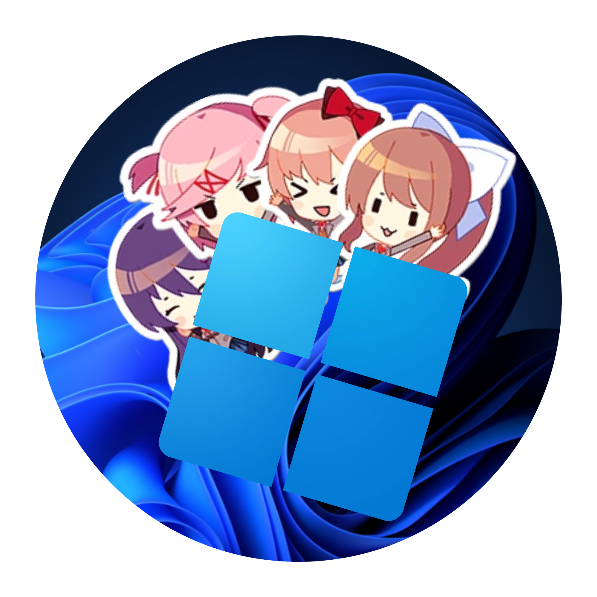

 

  

**Just Dokis Desktop** is a fork of DDLC Desktop that adds new features, allowing the girls to interact with your PC and with you in a much more entertaining way, while evolving toward a modular C++ core and cross-platform architecture.

[Website](https://umr-chan.github.io/DokisWeb-/main.html) · [Discord](https://discord.gg/wTjeeJRvJp)

---

## New Features

- **Windows commands and PC actions — 20% tested:** dynamic conversations with memory, expression changes, and automatic poses based on mood.
- **Desktop control:** the girls can interact intelligently with your Windows environment (windows, processes, volume, media playback, and system actions).
- **Expanded screen reading & process detection:** multimodal screen capture support and broader active application/media detection beyond Spotify alone.
- **Chibi & companion state system:** quick switching between normal and Chibi states, dynamic mood/status reactions (processing, idle, errors/rate limits), and modular C++ state management.
- **Minimal resource usage — cloud/local mode:** compatible with `deepseek-v4.1-flash:cloud` in Ollama for operation without local RAM usage.
- **English interface:** menus and interface updated to English. The translation is in an early stage and remains under development.
- **Additional model support:** improved integration with Ollama and Groq compatibility.

## Architecture & Roadmap

- **Modular C++ structure:** separating portable core logic (`shared_core/` — Gemini/API client, retry/backoff handling, Chibi state machine) from platform-specific code (`windows/` using Win32 API).
- **Windows installer (Inno Setup):** stabilized installer with manual path selection and validation checks (including `audio.archive`).
- **Android port (planned / in progress):** isolating portable C++ modules for future Android NDK / CMake / JNI integration without breaking the Windows desktop build.

## Recommended Models

Configure models from the application's **Settings** menu:

1. **Ollama Cloud — recommended:** `deepseek-v4.1-flash:cloud`  
   Free, fast, and without local resource consumption.
2. **Ollama Local:** `llama3:latest`  
   Fully offline and with no request limits.
3. **Groq Cloud:** `llama-3.3-70b-versatile` or `llama-3.1-8b-instant`.
4. **Offline multimodal models:** also supported.

## Preview

  

## Privacy and Responsible Use

Generative models such as Copilot, Gemini, Ollama, and Groq may be used for tasks including:

- executing actions on the PC;
- taking screenshots and analyzing images;
- identifying active processes and media states.

Note that images, active processes, and similar data may be sent to the companies responsible for free or multimodal models for training their services.

**Using local models whenever possible is recommended.** They may require significant system resources, and the author is not responsible for any problems caused by their use.

## Project Status

**Phase:** Moderately stable

To test a build, join the Discord server and contact the developer.

## Legal Notice

This project is an unofficial fork of Doki Doki Literature Club! and belongs to Team Salvato.

Just Dokis Desktop is distributed under the MIT license. See [LICENSE.txt](LICENSE.txt) for more information.
